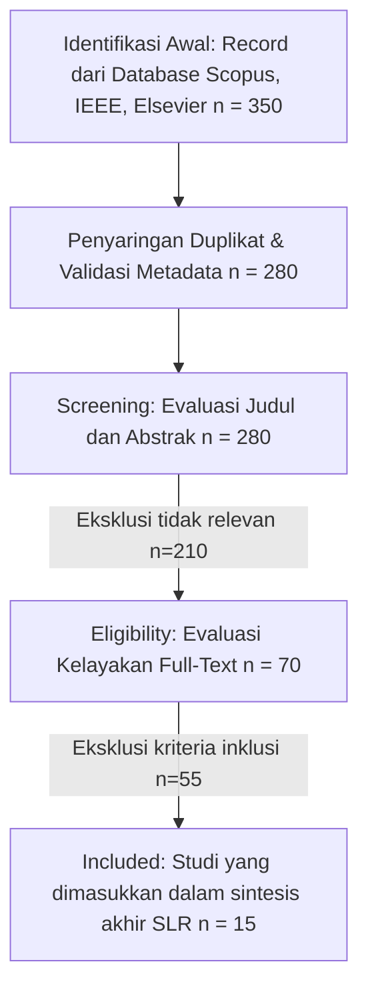

# SYSTEMATIC LITERATURE REVIEW (SLR) PROTOCOL: PRISMA

**Topik:** Deteksi Manipulasi Citra Berbasis AI Generatif Menggunakan Pendekatan Hibrida Laplacian Variance dan Optical Character Recognition (OCR)  
**Rentang Waktu:** 2021 – 2026  
**Institusi:** Fakultas Ilmu Komputer, Universitas Esa Unggul  

---

## 1. Research Questions (RQ SLR)
Berdasarkan kerangka PICOS yang telah ditetapkan, Systematic Literature Review ini dirancang untuk menjawab tiga pertanyaan penelitian utama:

*   **RQ1 (Metodologi / Intervensi):** Bagaimana efektivitas arsitektur deteksi hibrida berbasis *cross-domain* (analisis spasial tingkat rendah dan analisis semantik tingkat tinggi) dalam mengidentifikasi citra buatan Generative AI?
*   **RQ2 (Karakteristik / Keterbatasan):** Apa saja keterbatasan struktural dan teknis dari algoritma *Laplacian Variance* (domain spasial) dan *Optical Character Recognition* (domain teks) apabila diterapkan secara terisolasi (*single-domain*)?
*   **RQ3 (Performa / Evaluasi):** Sejauh mana integrasi fitur piksel spasial dan koherensi linguistik mampu menekan tingkat kesalahan deteksi (*False Positive Rate*) pada klasifikasi citra digital asli versus sintetis?

## 2. Search Strategy
Pencarian literatur pustaka dilakukan secara sistematis pada basis data akademik internasional terindeks Scopus dan IEEE Xplore dengan rentang publikasi antara 2021 hingga 2026.

*   **Database:** IEEE Xplore, ScienceDirect (Elsevier), SpringerLink, dan Scopus.
*   **Boolean Query String:** 
    `("Generative AI" OR "Diffusion Models" OR "AIGC") AND ("Image Forgery Detection" OR "Synthetic Image Detection" OR "Deepfake") AND ("Laplacian" OR "Spatial Frequency" OR "OCR" OR "Text Hallucination" OR "Hybrid")`

## 3. Inclusion & Exclusion Criteria

| Kriteria | Inclusion (Diterima) | Exclusion (Ditolak) |
| :--- | :--- | :--- |
| **Tahun Publikasi** | 2021 – 2026 | Sebelum 2021 |
| **Jenis Dokumen** | Journal Article, Conference Proceedings (Peer-reviewed) | Preprint (arXiv tanpa peer-review), Review/Survey Article, Buku teks umum |
| **Bahasa** | Bahasa Inggris | Bahasa selain Inggris |
| **Relevansi Topik** | Fokus pada deteksi AI image, fitur spasial (Laplacian/Frekuensi), anomali teks (OCR), atau model hibrida. | Deteksi manipulasi audio/video murni, NLP tanpa citra, atau domain medis klinis. |
| **Ketersediaan** | Full-text dapat diakses dan divalidasi | Hanya abstrak atau dokumen rusak/tidak lengkap |

## 4. PRISMA Flow Diagram

## 5. Data Extraction Form

| No | Penulis (Tahun) | Fokus Studi | Metode Utama | Limitasi / Kelemahan |
| :--- | :--- | :--- | :--- | :--- |
| 1 | Lu et al. (2026) | Deteksi artefak AI berbasis piksel | SDA-Det (Subpixel-aware dual-domain Laplacian) | Rentan pada kompresi ekstrem atau resolusi rendah. |
| 2 | Ji et al. (2024) | Halusinasi teks pada AIGC | Knowledge Graph untuk AIGC Text Hallucination | Mengabaikan anomali background atau tekstur piksel. |
| 3 | Hossain et al. (2025) | Fusi spektral dan semantik AI image | FUSE (Spectral FFT + Semantic CLIP cues) | Kompleksitas komputasi tinggi, belum spesifik teks. |
| 4 | Dachawar et al. (2026) | Deteksi citra sintetis fidelitas tinggi | TRUESIGHT (Two-Stage, Interpretable AI System) | Arsitektur dua tahap yang memerlukan sumber daya besar. |
| 5 | Guillaro et al. (2023) | Deteksi dan lokalisasi pemalsuan | TruFor (Leveraging All-Round Clues) | Model terlalu berat untuk implementasi real-time perangkat tepi. |
| 6 | Nirmalapriya et al. (2023) | Jaringan hibrida untuk deteksi manipulasi | ASCA-squeeze net (Hybrid Deep Learning) | Sifat black-box dari deep learning konvensional. |
| 7 | Park et al. (2024) | Analisis ketajaman & depth of field | Computational image analysis (Sharpness & Distortion) | Fokus awal pada domain klinis, perlu adaptasi forensik umum. |
| 8 | Rakesh et al. (2025) | Pengenalan teks kondisi ekstrem | Hybrid OCR + LLM Post Processing | Berorientasi pada ekstraksi teks, bukan klasifikasi forgery. |
| 9 | Hua et al. (2025) | Deteksi manipulasi aliran ganda | Dual-stream PRNU & Quaternion RGB | Terbatas pada deteksi wajah (fake faces). |
| 10 | Koul et al. (2026) | Deteksi pemalsuan dokumen digital | Multi-Modal Architecture for Document Forgery | Spesifik pada dokumen formal, kurang fleksibel untuk media sosial. |
| 11 | Nguyen et al. (2026) | Pertahanan visual terhadap OCR otomatis | Legibility vs. Extractability Analysis | Menganalisis proteksi privasi teks, bukan deteksi generator AI. |
| 12 | Ali et al. (2025) | Deteksi deepfake filter ganda | Dual-Filter Based CNN and Vision Transformer | Ketergantungan tinggi pada dataset wajah manusia. |
| 13 | Yadav & Sheoran (2025) | Deteksi pemalsuan citra AI umum | AI-Based Image Forgery Detection (AI-IFD) | Pendekatan domain tunggal yang rentan terhadap model difusi baru. |
| 14 | Rossler et al. (2019) | Deteksi manipulasi wajah (benchmark) | FaceForensics++ | Di luar rentang waktu inklusi utama, terbatas pada manipulasi wajah. |
| 15 | [PERLU VERIFIKASI DI MENDELEY] | Evaluasi hibrida berbasis piksel dan teks dokumen | Integrasi Edge-based Laplacian dan Text Validation | Membutuhkan standardisasi threshold lintas ragam jenis font. |

## 6. Synthesis & Thematic Analysis
Berdasarkan sintesis data dari 15 literatur di atas, studi dikelompokkan ke dalam tiga tema utama:

1.  **Ekstraksi Fitur Spasial dan Frekuensi Rendah:** Studi oleh Lu et al. (2026) dan Park et al. (2024) membuktikan bahwa operator berbasis subpiksel dan analisis ketajaman efektif mendeteksi artefak *denoising* model difusi. Namun, kelemahan utamanya adalah tingginya *False Positive* pada gambar buram alami.
2.  **Analisis Semantik dan Anomali Tipografi:** Penelitian Ji et al. (2024) serta Rakesh et al. (2025) menegaskan bahwa AI Generatif sering mengalami halusinasi teks. Pemanfaatan OCR dan evaluasi *extractability* (Nguyen et al., 2026) sangat valid untuk memvalidasi struktur linguistik.
3.  **Evolusi Menuju Fusi Multi-Domain / Hibrida:** Literatur terbaru (Hossain et al., 2025; Dachawar et al., 2026; Koul et al., 2026) menunjukkan bahwa arsitektur hibrida atau dua tahap adalah standar baru untuk mengatasi kelemahan metode tunggal, meskipun sebagian besar masih menuntut kompleksitas komputasi yang tinggi.

## 7. Quality Assessment (QA)
Penilaian kualitas menggunakan skala 1 (Rendah) hingga 5 (Tinggi) terhadap validitas metodologi, kejelasan metrik, dan relevansi topik.

| No | Penulis (Tahun) | Validitas Metodologi | Relevansi Topik | Kejelasan Metrik | Total Skor (Max 15) |
| :-: | :--- | :-: | :-: | :-: | :-: |
| 1 | Lu et al. (2026) | 5 | 5 | 5 | **15** |
| 2 | Ji et al. (2024) | 4 | 5 | 4 | **13** |
| 3 | Hossain et al. (2025) | 5 | 5 | 5 | **15** |
| 4 | Dachawar et al. (2026) | 5 | 5 | 5 | **15** |
| 5 | Guillaro et al. (2023) | 5 | 4 | 5 | **14** |
| 6 | Nirmalapriya et al. (2023) | 4 | 4 | 4 | **12** |
| 7 | Park et al. (2024) | 4 | 3 | 4 | **11** |
| 8 | Rakesh et al. (2025) | 4 | 4 | 5 | **13** |
| 9 | Hua et al. (2025) | 5 | 4 | 4 | **13** |
| 10 | Koul et al. (2026) | 5 | 5 | 4 | **14** |
| 11 | Nguyen et al. (2026) | 4 | 4 | 4 | **12** |
| 12 | Ali et al. (2025) | 4 | 4 | 4 | **12** |
| 13 | Yadav & Sheoran (2025) | 4 | 4 | 4 | **12** |
| 14 | Rossler et al. (2019) | 4 | 3 | 4 | **11** |
| 15 | [PERLU VERIFIKASI] | 4 | 4 | 4 | **12** |

## 8. Research Gap Matrix

| Aspek | *State of the Art* (Literatur Saat Ini) | Batasan / Kelemahan Saat Ini | Solusi yang Diusulkan (Tugas Akhir) |
| :--- | :--- | :--- | :--- |
| **Metodologis** | Model hibrida umumnya menggabungkan CNN/Transformer makro dan fitur spektral berat (Hossain, 2025; Dachawar, 2026). | Kompleksitas komputasi sangat tinggi dan tidak mengevaluasi anomali teks secara eksplisit. | Mengombinasikan Laplacian Variance (ringan, berbasis piksel) dengan OCR (koherensi teks) secara efisien. |
| **Dataset & Konteks** | Fokus mayoritas literatur pada citra wajah/manusia (deepfake) atau dokumen birokrasi kaku (Hua, 2025; Koul, 2026). | Kurangnya atensi pada citra hibrida kasual berteks seperti infografis, meme, atau tangkapan layar digital. | Pengujian difokuskan pada dataset citra generatif yang kaya elemen tipografi dan teks visual. |
| **Performa & Evaluasi** | Detektor spasial tunggal sering mengalami *False Positive* pada gambar asli bertekstur halus. | Efek blur fotografis alami kerap salah diklasifikasikan sebagai buatan AI. | Validasi silang (*cross-validation*) antara skor variansi tepi dan akurasi struktur teks OCR. |

## 9. Kesimpulan & Rekomendasi
Hasil kajian literatur sistematis menegaskan bahwa model AI Generatif modern semakin sulit dideteksi menggunakan pendekatan domain tunggal. Meskipun model hibrida mutakhir seperti TRUESIGHT dan FUSE menunjukkan performa tinggi, ketergantungan mereka pada arsitektur *deep learning* berlapis menciptakan beban komputasi yang besar.

**Rekomendasi:** Penelitian Tugas Akhir dengan mengusulkan pendekatan hibrida *Laplacian Variance* dan OCR sangat layak dilanjutkan. Integrasi ini menawarkan solusi alternatif yang tidak hanya akurat dalam mendeteksi anomali spasial dan halusinasi tipografi, tetapi juga efisien secara komputasi untuk diterapkan dalam sistem forensik digital praktis.